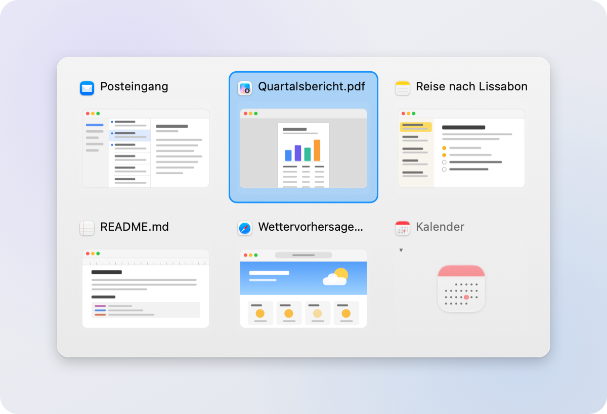

<p align="center">
  
</p>

# Tappi

[](https://github.com/leonatwork/Tappi/actions/workflows/build.yml)
[](https://github.com/leonatwork/Tappi/releases/latest)

[](LICENSE)
[](https://github.com/search?q=topic%3Ai-love-macos-but-i-miss-windows-features+user%3Aleonatwork&type=repositories)

Ein Fensterwechsler für macOS, der sich anfühlt wie Alt-Tab unter Windows — und zwar
**sofort**. Kein Warten, kein Ruckeln, keine CPU-Spitzen beim Drücken.

Standard-Hotkey: <kbd>⌘</kbd><kbd>Tab</kbd> — Tappi übernimmt die Tastenkombination vom System-Switcher.

*🇬🇧 [English version](README.md) — die englische Fassung ist maßgeblich und wird zuerst
aktualisiert.*

---

## Teil des Pakets

Tappi ist eines von vier Tools im Paket
**[I love macOS, but I miss some Windows features](https://github.com/search?q=topic%3Ai-love-macos-but-i-miss-windows-features+user%3Aleonatwork&type=repositories)**:

| Tool | Was es auf den Mac bringt | Download |
|---|---|---|
| **Tappi** (dieses Tool) | Alt+Tab zwischen Fenstern statt Apps | [Neuestes Release](https://github.com/leonatwork/Tappi/releases/latest) |
| [Klemmi](https://github.com/leonatwork/Klemmi) | Zwischenablage-Verlauf wie Win+V, mit Quell-App | [Neuestes Release](https://github.com/leonatwork/Klemmi/releases/latest) |
| [Snapline](https://github.com/leonatwork/snapline) | Snap Layouts, Aero Snap und Snap Assist aus Windows 11 | [Neuestes Release](https://github.com/leonatwork/snapline/releases/latest) |
| [Snapboard](https://github.com/leonatwork/snapboard) | Screenshots wie mit dem Snipping Tool, direkt in die Zwischenablage | [Neuestes Release](https://github.com/leonatwork/snapboard/releases/latest) |

Dir fehlt mehr als eine dieser Funktionen? Hol dir alle vier — jedes Tool läuft für sich,
zusammen fühlt sich macOS wie zu Hause an.

## Screenshot

<div align="center">
  
  <br />
  <em>Der Switcher nach einmal ⌘Tab: alle offenen Fenster in zuletzt-benutzt-Reihenfolge,
  mit Live-Vorschau — minimierte Fenster zeigen ihr App-Symbol</em>
</div>

## Warum

macOS' <kbd>⌘</kbd><kbd>Tab</kbd> wechselt **Apps**, nicht **Fenster**. Wer drei
Browserfenster und zwei Terminals offen hat, landet damit immer nur bei der App und muss
danach nochmal mit <kbd>⌘</kbd><kbd>`</kbd> weitersuchen. Windows wechselt seit jeher
zwischen einzelnen Fenstern — das ist der eigentliche Unterschied, an den man sich gewöhnt.

Es gibt bereits [AltTab](https://github.com/lwouis/alt-tab-macos), das dieses Verhalten
nachbildet. Der Grund für Tappi ist nicht der Funktionsumfang, sondern die Reaktionszeit.
AltTab berechnet die Fenstervorschauen **während man wartet** — das ist in dessen eigenen
Issues dokumentiert: rund 200 ms bei etwa zehn Fenstern
([#45](https://github.com/lwouis/alt-tab-macos/issues/45)), dazu Speicherprobleme durch
`replayd` ([#4194](https://github.com/lwouis/alt-tab-macos/issues/4194)) und spürbare
Verzögerungen bei vielen Fenstern ([#171](https://github.com/lwouis/alt-tab-macos/issues/171)).

Windows fühlt sich schnell an, weil der Compositor (DWM) die Fensterinhalte ohnehin schon
vorliegen hat. Der Switcher muss beim Tastendruck nichts mehr berechnen. Genau dieses
Prinzip setzt Tappi um.

## Das Windows-Verhalten, das hier nachgebaut ist

Recherchiert und Regel für Regel umgesetzt:

- Die Liste enthält **Fenster**, nicht Apps, sortiert nach zuletzt benutzt (MRU).
  Index 0 ist das aktuelle Fenster, Index 1 das davor.
- Beim Öffnen ist **Index 1 vorausgewählt**. Kurz drücken und loslassen springt daher
  direkt zum vorherigen Fenster.
- Die MRU-Reihenfolge wird **erst beim Loslassen** neu sortiert, nie während des
  Durchblätterns. Nur deshalb funktioniert das Hin-und-Her-Wechseln zwischen zwei Fenstern.
- <kbd>⇧</kbd> beim ersten Druck springt ans **Ende** der Liste.
- <kbd>Esc</kbd> bricht ab, ohne zu wechseln.
- <kbd>⌃</kbd> zusätzlich gedrückt öffnet die Liste **fixiert** — sie bleibt offen,
  auch wenn man den Modifier loslässt.
- Maus-Hover wählt aus, Klick wechselt, das „✕" auf der Kachel schließt das Fenster.

## Tastenbelegung

| Taste | Wirkung |
|---|---|
| <kbd>⌘</kbd><kbd>Tab</kbd> | Öffnen und vorwärts blättern |
| <kbd>⌘</kbd><kbd>⇧</kbd><kbd>Tab</kbd> | Rückwärts blättern |
| <kbd>⌘</kbd><kbd>^</kbd> | Nur Fenster der aktuellen App (die Taste über Tab) |
| <kbd>⌘</kbd><kbd>⌃</kbd><kbd>Tab</kbd> | Liste fixiert öffnen (bleibt offen) |
| Pfeiltasten | Auswahl bewegen |
| <kbd>⏎</kbd> / <kbd>Space</kbd> | Bestätigen |
| <kbd>Esc</kbd> | Abbrechen |
| <kbd>W</kbd> / <kbd>Backspace</kbd> (⌫) / <kbd>Entf</kbd> (Vorwärts-Entf, ⌦) | Ausgewähltes Fenster schließen |
| <kbd>Q</kbd> zweimal | App des ausgewählten Fensters beenden; der erste Druck zeigt einen Hinweis |

Im offenen Switcher folgen <kbd>W</kbd> und <kbd>Q</kbd> den Buchstaben des
ASCII-fähigen Tastaturlayouts (auch AZERTY und Dvorak), unabhängig von Modifiern
und Groß-/Kleinschreibung. Layoutwechsel greifen ohne Neustart. Hat das aktuelle
Layout kein lateinisches W oder Q, gilt für diesen Buchstaben die US-/ANSI-Position.
Zum Beenden <kbd>Q</kbd> drücken und loslassen, dann bei unveränderter Fensterauswahl
erneut drücken. Gedrückthalten bestätigt nicht. Jede andere Taste, Auswahländerung,
Abbruch oder das Sitzungsende verwirft die Anfrage samt Hinweis; es gibt kein
Bestätigungs-Timeout.

Gemeint ist jeweils die Taste **direkt über Tab** — auf deutschen Tastaturen <kbd>^</kbd>,
auf US-Tastaturen <kbd>`</kbd>. Die beiden Layouts vergeben dort unterschiedliche Keycodes
(ISO meldet 10, ANSI meldet 50, und auf ISO liegt 50 stattdessen auf <kbd><</kbd>), deshalb
akzeptiert Tappi beide.

Der Modifier lässt sich im Menüleisten-Menü auf <kbd>⌥</kbd> oder <kbd>⌃</kbd> umstellen.
<kbd>⌘</kbd> ist die Voreinstellung, weil die Taste dort liegt, wo auf einer PC-Tastatur Alt
liegt — direkt links neben der Leertaste.

### Der System-Switcher

<kbd>⌘</kbd><kbd>Tab</kbd> ist keine normale Tastenkombination: Der Window Server behandelt sie
als *Symbolic Hot Key*, noch bevor irgendein Event Tap sie zu sehen bekommt. Die Taste
abzufangen genügt deshalb nicht — der System-Switcher erscheint trotzdem vor Tappis Panel.
Tappi deaktiviert den Symbolic Hot Key daher, solange es läuft (private CoreGraphics-API,
dieselbe, die AltTab dafür nutzt).

Das ist mit einer Sicherung versehen: **Tappi nimmt <kbd>⌘</kbd><kbd>Tab</kbd> nur weg,
solange es nachweislich arbeitsfähig ist** — Bedienungshilfen erteilt, Event Tap aktiv und
Fenster tatsächlich sichtbar. Fällt eine dieser Bedingungen weg, geht die Tastenkombination
sofort ans System zurück. Auch beim Beenden und bei `SIGTERM`/`SIGINT` wird sie
wiederhergestellt; ein Start nach einem harten Abschuss repariert den Zustand.

## Geschwindigkeit

Gemessen auf macOS 26.6 (Apple Silicon) bei 12 offenen Fenstern mit aktivierten
Vorschaubildern — Zeit vom Tastendruck bis das Panel auf dem Bildschirm steht:

```
visible after 1.1 ms     visible after 1.0 ms
visible after 1.2 ms     visible after 1.7 ms
visible after 1.2 ms     visible after 1.0 ms
visible after 1.0 ms     visible after 1.2 ms
```

Nachmessen lässt sich das jederzeit mit `TAPPI_DEBUG=1` (siehe unten).

### Wie das erreicht wird

Die Regel lautet: **im Hotkey-Pfad wird nichts berechnet.**

- **Die Fensterliste ist immer warm.** Fenster, Titel, Icons und MRU-Reihenfolge werden
  laufend im Hintergrund gepflegt — angestoßen von Accessibility-Notifications, nicht vom
  Tastendruck. Beim Drücken wird ein fertiges Array gelesen.
- **Alle Accessibility-Aufrufe laufen abseits des Main Threads**, mit hartem Timeout
  (250 ms) pro App. Eine hängende App kann den Switcher damit nicht blockieren.
- **Das Panel existiert bereits.** Es wird beim Start einmal erzeugt und danach nur noch
  ein- und ausgeblendet, statt pro Aufruf neu aufgebaut zu werden.
- **Gezeichnet wird in einer einzigen `draw(_:)`-View** — keine Collection View, kein
  Auto Layout, kein SwiftUI-Diffing zwischen Tastendruck und Pixeln.
- **Vorschaubilder sind rein additiv.** Das Panel erscheint sofort mit App-Icons; die
  Live-Vorschau wird asynchron nachgeladen, in den Cache gelegt und blendet sich in die
  jeweilige Kachel ein. Gewartet wird darauf nie.

Der teuerste Einzelposten war übrigens nicht das Zeichnen, sondern
`CGPreflightScreenCaptureAccess()` — ein synchroner Aufruf an den TCC-Daemon, der pro
Sitzung 13× erfolgte und allein für 120–160 ms Verzögerung sorgte. Das Ergebnis wird jetzt
zwischengespeichert.

Im Leerlauf: rund 1 % CPU-Zeit und ~60 MB RSS.

## Installation

### Fertige App herunterladen

Neuestes Release: **[Tappi.app herunterladen](https://github.com/leonatwork/Tappi/releases/latest)**

1. ZIP entpacken und `Tappi.app` nach `/Applications` ziehen
2. Beim ersten Start `Tappi.app` einmal per Doppelklick starten und die Meldung schließen,
   dass der Start blockiert wurde. **Systemeinstellungen ▸ Datenschutz & Sicherheit**
   öffnen, nach unten scrollen zum Bereich „Sicherheit“ und bei Tappi auf **Dennoch öffnen**
   klicken. Falls angefordert, mit Passwort oder Touch ID bestätigen und mit **Öffnen**
   den Start der App bestätigen.

Schritt 2 erlaubt Gatekeeper, diese App zu öffnen, weil die Release-Builds nicht notarisiert
sind — dafür wäre ein kostenpflichtiges Apple-Entwicklerkonto erforderlich. Ab macOS 15
umgeht Rechtsklick ▸ Öffnen Gatekeeper nicht mehr. Alternativ:

```bash
xattr -dr com.apple.quarantine /Applications/Tappi.app
```

> Release-Builds nach 1.1.0 sind mit einem festen Zertifikat signiert, „leonatwork Code
> Signing“. Erteilte Berechtigungen **überstehen spätere Updates**. Wer von 1.1.0 oder
> älter kommt, die noch ad-hoc signiert waren, erteilt sie einmal neu. Das Zertifikat ist
> selbstsigniert und nicht von Apple, der Schritt beim ersten Start oben bleibt also nötig.

### Selbst bauen (empfohlen)

Es wird kein Xcode benötigt, die Command Line Tools genügen:

```bash
xcode-select --install
git clone https://github.com/leonatwork/Tappi.git
cd Tappi
./setup-signing.sh
./build.sh --install
```

`setup-signing.sh` legt einmalig eine lokale Signaturidentität an, damit die erteilten
Berechtigungen jeden künftigen Neubau überstehen (Details unter *Damit die Freigabe
erhalten bleibt*). Ohne `--install` landet das fertige Bundle nur in `./dist/`.


### Berechtigungen

- **Bedienungshilfen** (zwingend): Beim ersten Start erscheint der Systemdialog. Ohne
  diese Freigabe kann Tappi weder Tastendrücke sehen noch Fenster in den Vordergrund holen.
- **Bildschirmaufnahme** (optional): Nur für die Vorschaubilder. Da Vorschauen
  voreingestellt an sind, fragt Tappi beim Start danach, sobald sie fehlt. Ohne die
  Freigabe zeigen die Kacheln App-Symbole, alles andere funktioniert unverändert.

  macOS zeigt diesen Systemdialog **nur einmal pro App**. Wurde er einmal abgelehnt,
  führt der Weg nur noch über die Systemeinstellungen — dafür gibt es im Menü den Punkt
  *Bildschirmaufnahme freigeben …*. Und weil ScreenCaptureKit eine frisch erteilte
  Freigabe erst in einem neu gestarteten Prozess sieht, bietet das Menü danach
  *Neu starten, um Vorschauen zu aktivieren* an.

### Damit die Freigabe erhalten bleibt

macOS bindet erteilte Berechtigungen an die Codesignatur — und eine ad-hoc-Signatur wird
über den Hash der Binary identifiziert. **Jeder Neubau erzeugt damit eine neue Identität**,
für die der bestehende Eintrag nicht mehr gilt: Das Häkchen bleibt sichtbar, greift aber ins
Leere, und Tappi meldet „Bedienungshilfen fehlen", obwohl alles freigegeben aussieht.

Der Unterschied im Klartext:

```
ad-hoc        designated => cdhash H"..."               ← ändert sich bei jedem Build
Zertifikat    designated => certificate leaf = H"..."   ← bleibt stabil
```

Deshalb einmalig eine lokale Signaturidentität anlegen:

```bash
./setup-signing.sh
```

Das erzeugt ein selbstsigniertes Codesignatur-Zertifikat und legt es im Login-Schlüsselbund
ab. Ein Admin-Passwort ist nicht nötig: `codesign` akzeptiert eine nicht als vertrauenswürdig
markierte selbstsignierte Identität zum lokalen Signieren. `build.sh` verwendet sie danach
automatisch — die Berechtigungen überstehen jeden weiteren Neubau.

Eigene Builds und Release-Builds nutzen verschiedene Zertifikate. Ein Wechsel zwischen
beiden gilt für macOS deshalb als neue App, und die Berechtigungen müssen neu erteilt werden.

Wer eine Developer-ID hat, nimmt stattdessen diese:

```bash
CODESIGN_IDENTITY="Developer ID Application: Dein Name (TEAMID)" ./build.sh --install
```

### Freigaben zurücksetzen

Wenn aus einer früheren ad-hoc-Installation noch tote Einträge stammen, hilft ein Reset:

```bash
tccutil reset Accessibility de.tappi.Tappi
tccutil reset ScreenCapture de.tappi.Tappi
```

Danach Tappi neu starten und die Freigaben einmal erteilen.


## Einstellungen

Über das Menüleisten-Symbol: Sprache, Modifier, Einblendeverzögerung, Kachelgröße
(112–320 pt), Kacheln pro Zeile, Panel-Bildschirm, Vorschaubilder, minimierte Fenster,
Fenster anderer Spaces, Fenster ausgeblendeter Apps, Auswahl-per-Maus und Autostart. Dazu
*Einstellungsdatei öffnen*, *Diagnoseprotokoll öffnen* und *Tappi neu starten*.

Die Oberfläche gibt es auf Englisch, Deutsch, Französisch, Spanisch, Italienisch,
Portugiesisch (Brasilien), Niederländisch, Japanisch, vereinfachtem Chinesisch und
Koreanisch. Das Untermenü *Sprache* bietet *Systemstandard* und jede dieser Sprachen unter
ihrem eigenen Namen: *English*, *Deutsch*, *Français*, *Español*, *Italiano*,
*Português (Brasil)*, *Nederlands*, *日本語*, *简体中文* und *한국어*. *Systemstandard* folgt
den bevorzugten macOS-Sprachen und verwendet Englisch als Fallback. Änderungen werden beim
nächsten Öffnen des Menüs sichtbar und bleiben nach einem Neustart erhalten.

**Panel-Bildschirm** bietet *Aktiver Bildschirm* (Standard: Bildschirm des fokussierten
Fensters), *Unter dem Mauszeiger* und *Hauptbildschirm* (bisheriges Verhalten). Kann
der Bildschirm des aktiven Fensters nicht ermittelt werden, nutzt Tappi den Bildschirm
unter dem Mauszeiger, danach den Hauptbildschirm und schließlich den ersten verfügbaren
Bildschirm. Ohne Bildschirm wird kein Panel gezeigt. Das JSON-Feld `panelScreen`
akzeptiert `"active"`, `"mouse"` oder `"main"`; ein fehlendes Feld oder `null` bedeutet
`"active"`, bestehende Einstellungen bleiben erhalten.

Das Panel bleibt im sichtbaren Bereich des gewählten Bildschirms. Passen die Kacheln
nicht hinein, werden sie bei gleichem Seitenverhältnis bis auf 96 pt Breite verkleinert;
die ursprüngliche Spaltenzahl bleibt erhalten. Reicht das nicht, enthält die Sitzung
nur die zuletzt genutzten Fenster, die hineinpassen — für Maus- und Tastaturauswahl.
Passt nicht einmal eine Kachel in Mindestgröße, startet keine Umschaltsitzung. Bildschirm und Layout
bleiben bis zum Sitzungsende fest; Vorschauen verwenden den Backing-Faktor dieses Bildschirms.

Außerdem gibt es im Menü *Weitere Apps, die dir gefallen könnten* mit Links zu den anderen
Tools aus dem [Paket](#teil-des-pakets).

Die Statuszeile ganz oben im Menü sagt, woran es hakt: fehlende Bedienungshilfen, keine
erkannten Fenster oder „ohne Vorschauen".

Alles liegt als JSON in `~/Library/Application Support/Tappi/settings.json` und lässt sich
auch direkt bearbeiten. *Einstellungsdatei öffnen* öffnet sie im Standard-Texteditor, nie in
Xcode. Änderungen greifen beim nächsten Öffnen des Menüs, ohne Neustart. Fehlende, mit
`null` belegte oder ungültige Werte erhalten nur den Default ihres jeweiligen Felds;
alle anderen Einstellungen bleiben erhalten, unbekannte Keys werden ignoriert. Eine
unbekannte Sprache folgt der Systemsprache. Beim Laden wird die Datei nicht neu
geschrieben, sondern erst bei der nächsten Einstellungsänderung im Menü.

Eine unlesbare Datei oder ein ungültiges JSON-Dokument wird per `NSLog` protokolliert.
Beim Start verwendet Tappi Defaults, beim erneuten Laden bleiben die aktuellen
Einstellungen erhalten. Vor dem nächsten Speichern wird der ursprüngliche Inhalt als
`settings.json.bak` im selben Ordner gesichert (eine bestehende Sicherung wird ersetzt).
Schlägt die Sicherung fehl, wird die Originaldatei nicht überschrieben. `tileSize` und
`maxColumns` akzeptieren beliebige numerische Werte, nicht nur die Vorgaben aus dem Menü.

### App-Ausschlüsse (nur JSON)

Diese Felder im bestehenden JSON-Objekt ergänzen und die übrigen Einstellungen beibehalten:

```json
"excludedApps": [],
"passthroughApps": [
  "com.microsoft.rdc.macos",
  "com.parallels.desktop.console",
  "com.vmware.fusion",
  "com.utmapp.UTM",
  "com.citrix.receiver.icaviewer.mac"
]
```

- `excludedApps` (Liste A, standardmäßig leer) blendet alle Fenster der aufgeführten
  Bundle-IDs aus — sowohl in der Gesamtliste als auch beim Wechsel innerhalb der
  aktuellen App. Die Fenster bleiben im MRU-Speicher. Eine ID entfernen und das
  Menü zum Neuladen öffnen: Ab der nächsten Sitzung erscheinen die Fenster ohne
  Neustart wieder an ihren beibehaltenen MRU-Positionen.
- `passthroughApps` (Liste B) enthält standardmäßig die fünf IDs oben: Microsoft
  Remote Desktop / Windows App, Parallels Desktop, VMware Fusion, UTM und Citrix
  Viewer. Solange eine aufgeführte App vorne ist, startet Tappi keine Sitzung und
  schluckt keinen der beiden Umschalt-Hotkeys (auch nicht mit Shift oder als
  dauerhafte Sitzung). macOS bzw. die App können ⌘Tab und ⌘ plus die Taste über Tab
  wieder verarbeiten. Sobald eine andere App vorne ist, unterdrückt Tappi die
  System-Hotkeys erneut, sofern der ⌘-Modifier mit Systemersetzung eingestellt und
  Tappi bereit ist. Bei ⌥/⌃ umgeht Liste B ebenfalls Tappi; System-⌘Tab ist dann
  ohnehin nicht unterdrückt.

Beide Listen vergleichen Bundle-IDs ohne Beachtung der Groß-/Kleinschreibung und
wirken unabhängig: Liste B blendet keine Fenster aus, Liste A lässt keine Hotkeys
durch. Apps ohne Bundle-ID passen zu keiner Liste. Eine fehlende, mit `null` belegte
oder ungültige Liste erhält nur ihren eigenen Default; `"passthroughApps": []`
deaktiviert die Vorbelegung ausdrücklich. Änderungen greifen beim nächsten Öffnen
des Menüs. Neue Ausschlüsse entfernen passende Kacheln auch aus einer offenen
Sitzung; das Entfernen eines Ausschlusses wirkt ab der nächsten Sitzung. Kommt eine
App aus Liste B nach vorne, wird eine bereits laufende Sitzung nicht abgebrochen.
Wie Hotkeys innerhalb einer Remote-Sitzung weitergeleitet werden, hängt von der
Tastaturkonfiguration der jeweiligen App ab.

Die **Einblendeverzögerung** steht standardmäßig auf 0 ms (Windows-Verhalten). Wer beim
schnellen Hin-und-Her-Wechseln gar kein Panel sehen will, stellt sie auf 60–120 ms — dann
erscheint es nur, wenn man den Modifier tatsächlich gedrückt hält.

## Diagnose

Tappi protokolliert seinen Startvorgang immer nach:

```
~/Library/Application Support/Tappi/diagnostics.log
```

Dort steht, ob die Bedienungshilfen greifen, ob der Event Tap installiert werden konnte und
wie viele Fenster erkannt werden. Die Datei wird bei jedem Start neu angelegt.

Für Details zur Tastenverarbeitung:

```bash
TAPPI_DEBUG=1 /Applications/Tappi.app/Contents/MacOS/Tappi
```

Protokolliert jedes gesehene Tastenereignis samt Entscheidung, ob es geschluckt wurde,
sowie die Latenz jeder Sitzung. Achtung: aus dem Terminal gestartet erbt Tappi die
Berechtigungen des Terminals — für einen ehrlichen Berechtigungstest die App normal starten
und in die Log-Datei schauen.

## Bekannte Grenzen

- Fenster werden über die Accessibility-API erfasst. Apps mit unsauberer
  AX-Unterstützung (manche Java- und Electron-Anwendungen) melden ihre Fenster
  unvollständig.
- Der Wechsel zu einem Fenster auf einem anderen Space löst die übliche
  macOS-Space-Animation aus — daran kann Tappi nichts ändern.
- Das Abschalten des System-Switchers nutzt eine private CoreGraphics-API. Eine
  öffentliche Entsprechung gibt es nicht; ohne sie lässt sich <kbd>⌘</kbd><kbd>Tab</kbd>
  nicht übernehmen.
- Ad-hoc-Signaturen und macOS' Berechtigungsverwaltung vertragen sich schlecht — siehe
  „Damit die Freigabe erhalten bleibt".
- Es läuft immer nur eine Instanz: Startet eine zweite (etwa aus `dist/` neben der
  installierten), beendet sie sich sofort wieder. Zwei Instanzen hätten sonst je einen
  Event Tap installiert und jeden Tastendruck doppelt verarbeitet.
- Getestet auf macOS 26.6, Apple Silicon. Minimum ist macOS 14.

## Aufbau

| Datei | Aufgabe |
|---|---|
| `WindowStore.swift` | Immer aktuelle Fensterliste samt MRU-Reihenfolge |
| `SwitcherController.swift` | Zustandsautomat einer Sitzung (die Windows-Regeln) |
| `EventTap.swift` | Tastenereignisse abfangen, bevor die App sie sieht |
| `SwitcherPanel.swift` | Das vorgehaltene Overlay-Fenster |
| `SwitcherView.swift` | Layout und Zeichnen der Kacheln |
| `ThumbnailProvider.swift` | Asynchrone Vorschaubilder via ScreenCaptureKit |
| `AX.swift` | Accessibility-Aufrufe mit Timeout-Schutz |
| `SystemSwitcher.swift` | Übernahme von ⌘Tab samt Rückgabe-Sicherung |
| `StatusItem.swift` | Menüleisten-Menü |
| `InterfaceLanguage.swift` | Oberflächensprache und Textauswahl |
| `Resources/*.lproj` | Übersetzungen, eine `Localizable.strings` je Sprache |
| `scripts/generate-icon.swift` | Zeichnet das App-Symbol; `build.sh` ruft es auf |
| `Diagnostics.swift` | Startprotokoll für ein Programm ohne Konsole |

## Mitwirken

Fehlerberichte und Pull Requests sind willkommen — siehe **[CONTRIBUTING.md](CONTRIBUTING.md)**
(auf Englisch)
für Entwicklungsumgebung, Architektur und die Fallstricke, die schon einmal Zeit gekostet
haben. Änderungen pro Version stehen im **[CHANGELOG.md](CHANGELOG.md)**.

Bei Fehlerberichten bitte das Diagnoseprotokoll beilegen (Menüleisten-Symbol ▸
*Diagnoseprotokoll öffnen*). Es enthält keine Fenstertitel oder sonstigen Inhalte.

## Open Source & Premium

Tappi ist und bleibt Open Source unter der MIT-Lizenz. Alles in diesem Repository darf
weiterhin frei genutzt, verändert und weitergegeben werden.

Geplant sind zwei Wege, das Projekt zu unterstützen:

- **Sponsoring**: freiwillige Unterstützung der Weiterentwicklung. Der Link folgt hier,
  sobald er eingerichtet ist.
- **Premium-Erweiterungen**: optionale Zusatzfunktionen als separates, kostenpflichtiges
  Paket. Sie bauen auf dem freien Kern auf und nehmen ihm nie Funktionen weg.

## Lizenz

[MIT](LICENSE) — freie Nutzung, Änderung und Weitergabe, ohne Gewährleistung.

Tappi ist von Grund auf eigenständig geschrieben und teilt keinen Code mit
[AltTab](https://github.com/lwouis/alt-tab-macos). Für die Übernahme von ⌘Tab wird
dieselbe private CoreGraphics-Funktion verwendet, weil macOS dafür keine öffentliche
Entsprechung anbietet.
