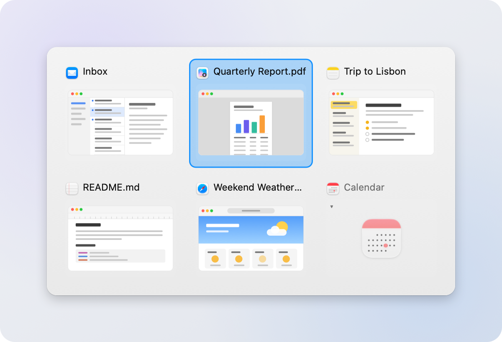

<p align="center">
  
</p>

# Tappi

[](https://github.com/leonatwork/Tappi/actions/workflows/build.yml)
[](https://github.com/leonatwork/Tappi/releases/latest)

[](LICENSE)
[](https://github.com/search?q=topic%3Ai-love-macos-but-i-miss-windows-features+user%3Aleonatwork&type=repositories)

A window switcher for macOS that feels like Alt-Tab on Windows — and appears
**instantly**. No waiting, no stutter, no CPU spike when you press the key.

Default hotkey: <kbd>⌘</kbd><kbd>Tab</kbd> — Tappi takes the shortcut over from the
system switcher.

*🇩🇪 [Deutsche Version](README.de.md)*

---

## Part of the package

Tappi is one of four tools in the package
**[I love macOS, but I miss some Windows features](https://github.com/search?q=topic%3Ai-love-macos-but-i-miss-windows-features+user%3Aleonatwork&type=repositories)**:

| Tool | What it brings to macOS | Download |
|---|---|---|
| **Tappi** (this tool) | Alt+Tab between windows, not apps | [Latest release](https://github.com/leonatwork/Tappi/releases/latest) |
| [Klemmi](https://github.com/leonatwork/Klemmi) | Clipboard history like Win+V, with the app each entry came from | [Latest release](https://github.com/leonatwork/Klemmi/releases/latest) |
| [Snapline](https://github.com/leonatwork/snapline) | Windows 11 Snap Layouts, Aero Snap and Snap Assist | [Latest release](https://github.com/leonatwork/snapline/releases/latest) |
| [Snapboard](https://github.com/leonatwork/snapboard) | Snipping-Tool-style screenshots straight to the clipboard | [Latest release](https://github.com/leonatwork/snapboard/releases/latest) |

Miss more than one of these on your Mac? Grab all four — each works on its own, and together
they make macOS feel like home.

## Screenshot

<div align="center">
  
  <br />
  <em>The switcher after one press of ⌘Tab: every open window in most-recently-used order,
  with live previews — minimized windows show their app icon</em>
</div>

## Why

macOS' <kbd>⌘</kbd><kbd>Tab</kbd> switches **apps**, not **windows**. With three browser
windows and two terminals open it only ever gets you to the app, and you then hunt for the
right window with <kbd>⌘</kbd><kbd>`</kbd>. Windows has always switched between individual
windows — that is the difference you actually feel.

[AltTab](https://github.com/lwouis/alt-tab-macos) already reproduces that behaviour. Tappi
does not exist because of features but because of latency. AltTab computes its window
previews **while you wait** — documented in its own issues: roughly 200 ms with about ten
windows ([#45](https://github.com/lwouis/alt-tab-macos/issues/45)), plus memory growth in
`replayd` ([#4194](https://github.com/lwouis/alt-tab-macos/issues/4194)) and noticeable
delays with many windows ([#171](https://github.com/lwouis/alt-tab-macos/issues/171)).

Windows feels fast because its compositor (DWM) already holds the window contents. The
switcher has nothing left to compute when you press the key. Tappi applies that same
principle.

## The Windows behaviour being reproduced

Researched and implemented rule by rule:

- The list contains **windows**, not apps, ordered by most recently used (MRU).
  Index 0 is the current window, index 1 the one before it.
- **Index 1 is preselected** on open, so a quick press-and-release jumps straight back to
  the previous window.
- MRU is re-ordered **only on release**, never while cycling. That is the sole reason
  toggling back and forth between two windows works.
- <kbd>⇧</kbd> on the first press jumps to the **end** of the list.
- <kbd>Esc</kbd> cancels without switching.
- Holding <kbd>⌃</kbd> as well opens the list **sticky** — it stays open after you let the
  modifier go.
- Hovering selects, clicking switches, and the "✕" on a tile closes that window.

## Keys

| Key | Action |
|---|---|
| <kbd>⌘</kbd><kbd>Tab</kbd> | Open and cycle forward |
| <kbd>⌘</kbd><kbd>⇧</kbd><kbd>Tab</kbd> | Cycle backward |
| <kbd>⌘</kbd><kbd>`</kbd> | Only windows of the current app (the key above Tab) |
| <kbd>⌘</kbd><kbd>⌃</kbd><kbd>Tab</kbd> | Open sticky (stays open) |
| Arrow keys | Move the selection |
| <kbd>⏎</kbd> / <kbd>Space</kbd> | Confirm |
| <kbd>Esc</kbd> | Cancel |
| <kbd>W</kbd> / <kbd>Backspace</kbd> / <kbd>Delete</kbd> (forward delete) | Close the selected window |
| <kbd>Q</kbd> twice | Quit the selected window's app; the first press shows a hint |

While the switcher is open, <kbd>W</kbd> and <kbd>Q</kbd> follow the letters in the
ASCII-capable keyboard layout (including AZERTY and Dvorak), ignoring modifiers
and letter case. Layout changes apply without restarting. If the current layout
has no Latin W or Q, that letter falls back to its US/ANSI position.
To quit, press and release <kbd>Q</kbd>, then press it again with the same window
selected. Holding Q does not confirm. Any other key, selection change, cancellation
or session end clears the request and its hint; there is no confirmation timeout.

The second shortcut means the key **directly above Tab** — <kbd>`</kbd> on US keyboards,
<kbd>^</kbd> on German ones. The two layouts assign different keycodes there (ISO reports
10, ANSI reports 50, and on ISO the 50 sits on <kbd><</kbd> instead), so Tappi accepts
both.

The modifier can be changed to <kbd>⌥</kbd> or <kbd>⌃</kbd> from the menu bar.
<kbd>⌘</kbd> is the default because it sits where Alt sits on a PC keyboard — directly
left of the space bar.

### The system switcher

<kbd>⌘</kbd><kbd>Tab</kbd> is not an ordinary shortcut: the window server handles it as a
*symbolic hot key* before any event tap ever sees it. Swallowing the keystroke is
therefore not enough — the system switcher still appears in front of Tappi's panel. Tappi
disables that symbolic hot key while it runs (a private CoreGraphics API, the same one
AltTab uses for this).

That comes with a safeguard: **Tappi only takes <kbd>⌘</kbd><kbd>Tab</kbd> away while it
is demonstrably able to do the job** — Accessibility granted, event tap active, windows
actually visible. If any of that stops being true, the shortcut goes straight back to the
system. It is also restored on quit and on `SIGTERM`/`SIGINT`, and a launch after a hard
kill repairs the state.

## Speed

Measured on macOS 26.6 (Apple Silicon) with 12 open windows and previews enabled — time
from keypress to the panel being on screen:

```
visible after 1.1 ms     visible after 1.0 ms
visible after 1.2 ms     visible after 1.7 ms
visible after 1.2 ms     visible after 1.0 ms
visible after 1.0 ms     visible after 1.2 ms
```

You can measure it yourself any time with `TAPPI_DEBUG=1` (see *Diagnostics*).

### How that is achieved

The rule is: **nothing is computed on the hotkey path.**

- **The window list is always warm.** Windows, titles, icons and MRU order are maintained
  continuously in the background, driven by Accessibility notifications rather than by the
  keypress. Pressing the key reads a finished array.
- **Every Accessibility call runs off the main thread**, with a hard 250 ms timeout per
  app. A wedged application cannot stall the switcher.
- **The panel already exists.** It is created once at launch and merely ordered in and out
  afterwards, instead of being rebuilt per invocation.
- **Drawing happens in a single `draw(_:)` view** — no collection view, no auto layout, no
  SwiftUI diffing between keypress and pixels.
- **Previews are purely additive.** The panel appears immediately with app icons; live
  previews are captured asynchronously, cached, and faded into their tile. Nothing ever
  waits for them.

The most expensive item, incidentally, was not drawing but
`CGPreflightScreenCaptureAccess()` — a synchronous round trip to the TCC daemon that ran
13× per session and accounted for 120–160 ms on its own. Its result is cached now.

Idle cost: roughly 1 % CPU time and ~60 MB RSS.

## Installation

### Download the app

Latest release: **[Download Tappi.app](https://github.com/leonatwork/Tappi/releases/latest)**

1. Unzip and drag `Tappi.app` into `/Applications`
2. On first launch, double-click `Tappi.app` once and dismiss the blocked-launch alert.
   Open **System Settings ▸ Privacy & Security**, scroll down to the Security section,
   and click **Open Anyway** for Tappi. Authenticate with your password or Touch ID if
   prompted, and confirm with **Open** to launch the app.

Step 2 allows Gatekeeper to open this app because release builds are not notarised —
that would require a paid Apple developer account. On macOS 15 and later, right-click
▸ Open no longer bypasses Gatekeeper. Alternatively:

```bash
xattr -dr com.apple.quarantine /Applications/Tappi.app
```

> Release builds after 1.1.0 are signed with a stable certificate, "leonatwork Code
> Signing". Permissions you grant **survive later updates**. Coming from 1.1.0 or earlier,
> which were ad-hoc signed, you grant them once more. The certificate is self-signed, not
> issued by Apple, so the first-launch step above is still needed.

### Build it yourself (recommended)

Xcode is not required, the Command Line Tools are enough:

```bash
xcode-select --install
git clone https://github.com/leonatwork/Tappi.git
cd Tappi
./setup-signing.sh
./build.sh --install
```

`setup-signing.sh` creates a local signing identity once, so granted permissions survive
every future rebuild (see *Keeping permissions working*). Without `--install` the finished
bundle is left in `./dist/`.

On the first build, macOS may show a one-time keychain dialog asking you to allow
`codesign` to use the private key. If signing fails (for example, access is denied
or `CODESIGN_IDENTITY` is invalid), `build.sh` shows the signing error and aborts
before installation. It does not retry without Hardened Runtime.

### Permissions

- **Accessibility** (required): the system dialog appears on first launch. Without it
  Tappi can neither see keystrokes nor bring windows to the front.
- **Screen Recording** (optional): only for the window previews. Since previews are on by
  default, Tappi asks at launch when the permission is missing. Without it the tiles show
  app icons and everything else works unchanged.

  macOS shows that system dialog **only once per app**. Once dismissed, the only remaining
  route is System Settings — which is why the menu offers *Grant Screen Recording…*. And
  because ScreenCaptureKit only picks up a fresh grant in a newly started process, the menu
  then offers *Restart to enable previews*.

### Keeping permissions working

macOS ties granted permissions to the code signature — and an ad-hoc signature is
identified by the hash of the binary itself. **Every rebuild therefore creates a new
identity** that the existing grant no longer covers: the checkbox stays ticked but no
longer applies, and Tappi reports missing Accessibility while everything looks correctly
granted.

The difference in plain terms:

```
ad-hoc        designated => cdhash H"..."               ← changes on every build
certificate   designated => certificate leaf = H"..."   ← stable
```

So create a local signing identity once:

```bash
./setup-signing.sh
```

This generates a self-signed code signing certificate and puts it in your login keychain.
No admin password is needed: `codesign` accepts an untrusted self-signed identity for
local signing. `build.sh` picks it up automatically from then on, and the permissions
survive every further rebuild.

Your own builds and the release builds use different certificates. Switching between the
two therefore counts as a new app for macOS, and the permissions have to be granted again.

With a Developer ID, use that instead:

```bash
CODESIGN_IDENTITY="Developer ID Application: Your Name (TEAMID)" ./build.sh --install
```

### Resetting permissions

If dead entries remain from an earlier ad-hoc installation, reset them:

```bash
tccutil reset Accessibility de.tappi.Tappi
tccutil reset ScreenCapture de.tappi.Tappi
```

Then restart Tappi and grant the permissions once.

## Settings

From the menu bar icon: language, modifier, show delay, tile size (112–320 pt), tiles per
row, panel screen, previews, minimized windows, windows on other Spaces, windows of
hidden apps, mouse selection and launch at login. Plus *Open settings file*, *Open diagnostics log* and
*Restart Tappi*.

The interface is available in English, German, French, Spanish, Italian, Portuguese
(Brazil), Dutch, Japanese, Simplified Chinese and Korean. The *Language* submenu offers
*System default* plus each of these, listed under its own name: *English*, *Deutsch*,
*Français*, *Español*, *Italiano*, *Português (Brasil)*, *Nederlands*, *日本語*, *简体中文*
and *한국어*. *System default* follows your macOS preferred languages and falls back to
English. Changes apply when you next open the menu and are saved across restarts.

**Panel screen** offers *Active screen* (default: the focused window's screen),
*Under the mouse pointer* and *Main screen* (the previous behavior). If the active
window's screen cannot be determined, Tappi uses the mouse pointer's screen, then
the main screen, then the first available screen. With no screen, no panel is shown.
The JSON field `panelScreen` accepts `"active"`, `"mouse"` or `"main"`; a missing
field or `null` means `"active"` and preserves existing preferences.

The panel stays inside the selected screen's visible area. When tiles do not fit,
they shrink with the same aspect ratio down to 96 pt wide, keeping the original
column count. If that is still too large, only the most recently used windows that
fit are included in that session, for both mouse and keyboard selection. If not
even one minimum-size tile fits, no switching session starts. Screen and layout stay fixed until
the session ends; previews use that screen's backing scale.

The menu also has *More apps you might like*, linking to the other tools of the
[package](#part-of-the-package).

The status line at the top of the menu tells you what is wrong: missing Accessibility, no
windows detected, or "without previews".

Everything lives as JSON in `~/Library/Application Support/Tappi/settings.json` and can be
edited directly. *Open settings file* opens it in your default text editor, never in Xcode.
Changes take effect the next time you open the menu, no restart needed. Missing, null or
invalid values use the default for that field only; other settings are preserved and
unknown keys are ignored. An unknown language follows the system language. Loading does
not rewrite the file: settings are saved on the next menu change.

An unreadable file or invalid JSON document is logged via `NSLog`. Tappi uses defaults at
startup or keeps the current settings during a reload. Before the next save, the original
contents are backed up to `settings.json.bak` in the same folder (replacing any previous
backup). If the backup fails, the original file is not overwritten. `tileSize` and
`maxColumns` accept any numeric value, not just the presets.

### App exclusions (JSON only)

Add these fields to the existing JSON object, preserving your other preferences:

```json
"excludedApps": [],
"passthroughApps": [
  "com.microsoft.rdc.macos",
  "com.parallels.desktop.console",
  "com.vmware.fusion",
  "com.utmapp.UTM",
  "com.citrix.receiver.icaviewer.mac"
]
```

- `excludedApps` (list A, empty by default) hides all windows of the listed bundle
  IDs in both the all-window and current-app switchers. It does not remove windows
  from the MRU store. Remove an ID and reopen the menu to reload: the next session
  includes those windows again at their retained MRU positions, without restarting.
- `passthroughApps` (list B) defaults to the five IDs above: Microsoft Remote
  Desktop / Windows App, Parallels Desktop, VMware Fusion, UTM and Citrix Viewer.
  While a listed app is frontmost, Tappi does not start a session or swallow either
  switching shortcut (including Shift and sticky variants). macOS/app handling of
  ⌘Tab and ⌘ plus the key above Tab is enabled again; Tappi suppresses the system
  shortcuts again when an ordinary app comes forward, if command-modifier
  replacement is configured and Tappi is ready. With option/control as modifier,
  list B still bypasses Tappi, but system ⌘Tab is not suppressed anyway.

Both lists compare bundle IDs case-insensitively and are independent: list B does
not hide windows, and list A does not bypass shortcuts. Apps without a bundle ID
do not match either list. A missing, null or invalid list uses only that list's
default; `"passthroughApps": []` explicitly disables its preset. Edits apply when
you next open the menu. Adding an exclusion also removes matching tiles from an
open session; removing it takes effect in the next session. A foreground change
to a list-B app does not cancel a session already in progress. Actual shortcut
routing inside a remote session depends on that app's keyboard configuration.

The **show delay** defaults to 0 ms (Windows parity). Set it to 60–120 ms if you would
rather not see the panel at all during fast back-and-forth toggling — it then only appears
when you actually hold the modifier.

## Diagnostics

Tappi always logs its startup to:

```
~/Library/Application Support/Tappi/diagnostics.log
```

It records whether the permissions apply, whether the event tap could be installed, and
how many windows are detected. The file is recreated on every launch and contains no
window titles or other content.

For detail on key handling:

```bash
TAPPI_DEBUG=1 /Applications/Tappi.app/Contents/MacOS/Tappi
```

This logs every key event it sees along with the decision whether it was swallowed, plus
the latency of each session. Note that when started from a terminal, Tappi inherits the
terminal's permissions — for an honest permission test, launch the app normally and read
the log file.

## Known limitations

- Windows are discovered through the Accessibility API. Apps with poor AX support (some
  Java and Electron applications) report their windows incompletely.
- Switching to a window on another Space triggers the usual macOS Space animation. Tappi
  cannot do anything about that.
- Disabling the system switcher uses a private CoreGraphics API. There is no public
  equivalent; without it <kbd>⌘</kbd><kbd>Tab</kbd> cannot be taken over.
- Ad-hoc signatures and macOS' permission handling interact badly — see *Keeping
  permissions working*.
- Only one instance runs at a time: starting a second one (say from `dist/` next to the
  installed copy) makes it exit immediately. Two instances would each install an event tap
  and double-handle every keystroke.
- Tested on macOS 26.6, Apple Silicon. Minimum is macOS 14.

## Layout

| File | Role |
|---|---|
| `WindowStore.swift` | Always-current window list and MRU order |
| `SwitcherController.swift` | State machine of one session (the Windows rules) |
| `EventTap.swift` | Intercepting key events before the focused app sees them |
| `SwitcherPanel.swift` | The pre-built overlay window |
| `SwitcherView.swift` | Tile layout and drawing |
| `ThumbnailProvider.swift` | Asynchronous previews via ScreenCaptureKit |
| `SystemSwitcher.swift` | Taking over ⌘Tab, with a guaranteed hand-back |
| `AX.swift` | Accessibility calls with timeout protection |
| `Diagnostics.swift` | Startup log for a program with no console |
| `StatusItem.swift` | Menu bar menu |
| `InterfaceLanguage.swift` | Interface language and string lookup |
| `Resources/*.lproj` | Translations, one `Localizable.strings` per language |
| `scripts/generate-icon.swift` | Draws the app icon; `build.sh` runs it |

## Contributing

Bug reports and pull requests are welcome — see **[CONTRIBUTING.md](CONTRIBUTING.md)** for
the development setup, the architecture, and the pitfalls that have already cost time.
Per-version changes are in **[CHANGELOG.md](CHANGELOG.md)**.

For bug reports please attach the diagnostics log (menu bar icon ▸ *Open diagnostics log*).
It contains no window titles or other content.

## Open source & premium

Tappi is and stays open source under the MIT License. Everything in this repository
remains free to use, modify and share.

Two ways to support the project are planned:

- **Sponsoring**: voluntary support for ongoing development. The link follows here as soon
  as it is set up.
- **Premium add-ons**: optional extra features, offered as a separate paid package. They
  build on the free core and never take features away from it.

## License

[MIT](LICENSE) — free to use, modify and redistribute, without warranty.

Tappi is written from scratch and shares no code with
[AltTab](https://github.com/lwouis/alt-tab-macos). Taking over ⌘Tab uses the same private
CoreGraphics function, because macOS offers no public equivalent.
